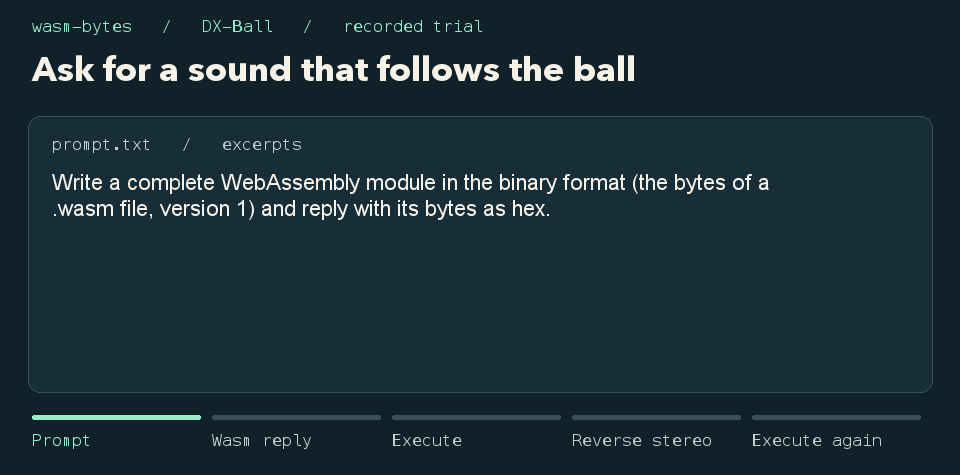
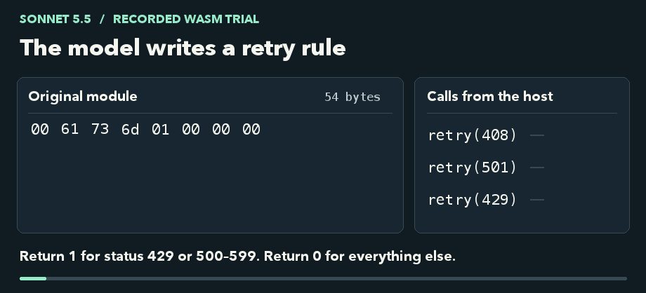

# wasm-bytes

Can a language model write a program directly as WebAssembly bytes? In this experiment, you describe a function in English, the model replies with every byte of a WebAssembly (Wasm) file, and a checker runs those bytes without changing any. Claude Sonnet 5.5 answered the first prompt with 54 bytes: a complete file, from the Wasm header to the final instruction, that an application can load and call. [Exact prompt](trials/write/claude-sonnet-5-5-1/prompt.txt) · [Unedited reply](trials/write/claude-sonnet-5-5-1/reply.txt)

<p class="actions"><a href="https://benoitc.github.io/wasm-bytes/demo/pan/">Try the sound demo</a> <a href="#from-the-models-reply-to-a-function-call">See the prompt and reply</a></p>

The idea comes from George Xenos and Sotiris Giannopoulos’s experiment in writing native executables byte by byte. Using Wasm gives us a way to take one model reply and run it inside an Erlang application, in JavaScript, or in a standalone runtime such as Wasmtime. [Programming in the Machine Code Space](https://sgiannopoulos.github.io/blog/machine-code-programming/)

## What would an application do with these bytes?

Imagine a weather app asking a server for today’s forecast. If the server replies `429 Too Many Requests`, it makes sense to try again later. If it replies `404 Not Found`, asking for the same page again is unlikely to help. How does the app decide?

We gave the model a simple rule for this app. Try again after a 429 or any status from 500 through 599. Stop for every other status. We asked it to write a complete Wasm module with one function, `retry`, that makes that decision. [Read the prompt](prompts/write.txt)

The app loads the module once. When a response arrives, it passes the status code to `retry`. Calling `retry(429)` returns `1`, so the app schedules another attempt. Calling `retry(404)` returns `0`, so it stops. The app handles the network request and decides how long to wait.

In Wasm terminology, the app is the **host**, and `retry` is an **export**, a function the host can call by name.

## From the model’s reply to a function call

Here is Sonnet’s entire answer to the first prompt. Each pair of hexadecimal digits represents one byte of the file.

```text
00 61 73 6d 01 00 00 00
01 06 01 60 01 7f 01 7f
03 02 01 00
07 09 01 05 72 65 74 72 79 00 00
0a 15 01 13 00 20 00 41 ad 03 46 20 00 41 f4 03 6b 41 e4 00 49 72 0b
```

The first eight bytes identify the file as a Wasm module and give its format version. The fourth line contains the name `retry` (`72 65 74 72 79`), and the last line contains the function body. To try the weather app’s two calls yourself, run these commands from the repository root with `xxd` and Wasmtime installed.

```sh
xxd -r -p trials/write/claude-sonnet-5-5-1/reply.txt > retry.wasm
wasmtime run -W fuel=10000 --invoke retry retry.wasm 429
wasmtime run -W fuel=10000 --invoke retry retry.wasm 404
```

The calls print `1` and `0`. The first command simply converts the model’s text to bytes. The next two load those bytes and call the exported function. [Call the same file from Node.js](doc/runner.md#call-the-module-from-nodejs)

Now suppose the app should also retry after a timeout (`408`) and stop when the server says a feature is unimplemented (`501`). We gave Sonnet its original bytes and asked for those two changes. The app can load the revised module and keep calling `retry(status)` exactly as before. In the recorded run, `retry(408)` changed from 0 to 1, `retry(501)` changed from 1 to 0, and the other 526 tested answers stayed the same. [Revision prompt](trials/revise/claude-sonnet-5-5-1/prompt.txt) · [Revised reply](trials/revise/claude-sonnet-5-5-1/reply.txt)

## How can you check a model’s answer before using it?

With Erlang/OTP 29 or later and rebar3 installed, replay the experiment locally. The first run fetches the pinned runtime from Hex. You can replay the saved replies without a model account.

```sh
bin/wasm-bytes replay
```

**Can it run safely within this task’s limits?** The Erlang runtime, `erlang_wasm`, validates the module’s instructions. The checker then requires exactly one exported function and rejects imports, memory, and start functions. That gives `retry` no host function for opening a socket or reading a file. Each test call gets fresh state, a budget of 10,000 units of work (“fuel”), and a one-second deadline. The replay includes a deliberately looping example so you can see what happens when a call runs out of fuel. [erlang_wasm](https://github.com/benoitc/erlang_wasm) · [Execution limits and verdicts](doc/runner.md)

**Does it make the right decision?** The checker compares each result with an independently written Erlang function. Sonnet’s module matched on all 528 inputs. Another example runs successfully but returns 0 for status 599, where the client expects 1. You can see that failure below. [Replay evidence](doc/evidence.md)

**Does the same file work elsewhere?** This command compares erlang_wasm and Wasmtime on the same 528 inputs. It checks the module’s SHA-256 fingerprint so you can verify both engines received identical bytes. Wasmtime must be on your `PATH` for this comparison.

```sh
bin/wasm-bytes compare write trials/write/claude-sonnet-5-5-1/reply.txt
```

Both engines matched all 528 answers on macOS arm64 and in Linux containers on arm64 and emulated x86_64. All three runs used one Mac. [Recorded module fingerprint](trials/write/claude-sonnet-5-5-1/module.sha256) · [Platform runs and how to repeat them](doc/evidence.md#3-the-same-bytes-in-another-engine-and-on-other-hosts)

## Reading and writing: 32-bit addition

The experiment also runs in the other direction. In a reading task, the model sees a module's bytes and predicts what one call returns. In a writing task, it gets an English description and writes the module. Both start here with 32-bit integer addition from the official WebAssembly spec tests.

**Reading.** The model sees the module as hex and one question. The prompt has no operation name, no source code, and no answer. [Exact prompt](trials/cases/spec/read/add-41/claude-sonnet-5-5-1/prompt.txt)

```text
00 61 73 6d 01 00 00 00 01 07 01 60 02 7f 7f 01
7f 03 02 01 00 07 05 01 01 66 00 00 0a 09 01 07
00 20 00 20 01 6a 0b

What signed integer does f(2147483647, 1) return? Reply with just the number.
```

The module's function `f` adds its two arguments. 2147483647 is the largest signed 32-bit integer, so adding 1 wraps around to −2147483648, the value the spec tests assert. Sonnet replied with just `-2147483648`. Check that reply:

```sh
bin/wasm-bytes check case spec/read/add-41 trials/cases/spec/read/add-41/claude-sonnet-5-5-1/reply.txt
```

```text
  call     f(2147483647, 1)
  answer   -2147483648
  expected -2147483648
  verdict  pass
```

`pass` means the reply is that one number. A reply of `2147483648`, the same bits read as unsigned, gets `wrong_answer`. A sentence around the right number gets `malformed_answer`, because the checker reads nothing out of a longer reply. [Both examples](examples/cases/spec/read/add-41/)

**Writing.** The model receives this sentence, followed by the rules for formatting the reply: "Write a complete WebAssembly module that exports f(i32, i32) -> i32. It adds its two arguments, wrapping on 32-bit overflow. Reply with the complete file as hex." Sonnet sent back 39 bytes. Check them:

```sh
bin/wasm-bytes check case spec/write/add trials/cases/spec/write/add/claude-sonnet-5-5-1/reply.txt
```

```text
  hex      39 bytes
  wasm     decodes and validates (erlang_wasm 0.11.0)
  profile  exports f : (i32, i32) -> (i32); no imports
  calls    8 inputs, each in a fresh instance; fuel 10000 and a 1000 ms deadline per call
  answers  8 of 8 match the reference
  verdict  pass
```

erlang_wasm validated the module, and the runner called `f` on the 8 inputs the spec tests assert for addition, including the overflow. `pass` means every call returned the asserted value. Any module that does so passes, whatever its bytes. These 39 happen to equal the module in the reading prompt, although the writing prompt never showed it. With Wasmtime installed, `bin/wasm-bytes compare case spec/write/add` runs the same bytes there too. [Exact prompt](trials/cases/spec/write/add/claude-sonnet-5-5-1/prompt.txt) · [Unedited reply](trials/cases/spec/write/add/claude-sonnet-5-5-1/reply.txt)

**A valid module with a wrong answer.** This hand-written reply is the same module with one byte changed: `6a` (`i32.add`) became `6b` (`i32.sub`). It decodes, validates, and runs, and the check names the first input where it differs.

```sh
bin/wasm-bytes check case spec/write/add examples/cases/spec/write/add/subtracts/reply.txt
```

```text
  wrong    6 answers differ from the reference
  first    input (1, 1): expected 2, got 0
  answers  2 of 8 match the reference
  verdict  wrong_answer
```

**The batches.** Sonnet also answered a sample drawn from three public sources: the spec tests, real binaries from WasmBench, and CodeContests problems. Replay one track's totals:

```sh
bin/wasm-bytes batch spec claude-sonnet-5-5-1
```

```text
  track    spec, replies labelled claude-sonnet-5-5-1
  source   374 examined, 364 usable, 10 skipped
           skipped 10: the call traps, so there is no value to predict
  read     12 correct predictions out of 12 attempted calls
           0 cases with no saved reply
  write    8 of 8 first replies were valid modules
           8 of 8 passed every behavioral check
           0 cases with no saved reply
```

The other two tracks, how each sample was drawn from its pinned source, and how to run a larger corpus are in the guide. [Reading and writing tracks](doc/datasets.md) · [Results](doc/status.md#reading-and-writing-tracks)

## A second function that does arithmetic

`digit_sum` takes an integer and adds its decimal digits. A host calling `digit_sum(407)` gets 11 back because 4 + 0 + 7 = 11. Calling `digit_sum(-407)` gives the same answer because the function ignores the sign. It uses the same Wasm interface as `retry` (one integer in, one integer out), but here the returned number is the answer to a calculation.

This task tests whether the model can encode a loop that extracts one digit at a time and keeps a running total. Here is how to check Haiku’s 95-byte reply. It matched the reference on all 1,353 tested inputs, including the smallest signed 32-bit integer, −2147483648, whose digits sum to 47. [Exact prompt](prompts/digits.txt) · [Recorded replies and results](doc/status.md#a-slightly-larger-program-digit_sum)

```sh
bin/wasm-bytes check digits trials/digits/claude-haiku-5-5-1/reply.txt
```

## How we reused a DX-Ball sound rule

The sound demo is the second example. It reuses one rule from the 1996 game DX-Ball: how far left or right a sound plays when the ball hits a brick.

**What REA did.** REA is a tool for understanding compiled programs. Its team used it to inspect the old game and published the calculation that turns a brick’s position into a number for the sound system. That calculation is what this project took from REA: we used it to write the prompt, and the model wrote the Wasm. You can build and run the demo without REA. In our browser demo, −500 means the left speaker, 0 means the middle, and 500 means the right speaker. [REA case study](https://github.com/morluto/rea#dx-ball-reconstruct-a-sound-pan-calculation)

**What we asked Claude to do.** We put REA’s calculation in a prompt and asked Claude to write a function called `screen_pan` that our app could load. Here is the opening instruction from the prompt. “Write a complete WebAssembly module in the binary format (the bytes of a .wasm file, version 1) and reply with its bytes as hex.” [Full prompt](trials/pan/claude-sonnet-5-5-1/prompt.txt)

**What a developer gets.** Sonnet returned a 76-byte program. The app calls `screen_pan(640)`, gets back `500`, and plays the sound on the right. We gave Sonnet those bytes and asked it to reverse the stereo. With the revised file, the exact same call returns `−500`, so the sound plays on the left. A developer can swap that one rule without rewriting the app or calling an AI service during playback. Both versions matched the published rule at all 641 positions, every x from 0 through 640. [Original reply](trials/pan/claude-sonnet-5-5-1/reply.txt) · [Change request](trials/reverse/claude-sonnet-5-5-1/prompt.txt) · [Revised reply](trials/reverse/claude-sonnet-5-5-1/reply.txt)



To hear it, open the [live demo](https://benoitc.github.io/wasm-bytes/demo/pan/) or run the command below. Turn **Sound** on, watch the ball reach the right edge, then select **Reversed**. [The whole flow, from REA's finding to the speaker](doc/dx-ball.md)

```sh
bin/wasm-bytes pan-demo
```

## Can the model write the demo page too?

The page that moves the ball and plays the beeps was written by hand. We also asked each model to write that page as one HTML file. The prompt fixes how the page gets the recorded modules and which buttons it needs. It also asks the page to work on an iPhone with the silent switch on. A browser check then drives each page in Chrome. It records every call to `screen_pan` and every beep the page plays, then swaps in stand-in modules to confirm the page doesn't compute the pan itself. The three Claude pages passed every check. A local model's page missed only the iPhone playback request, and passed every check once a guided prompt named the API to call. A second prompt also describes how the hand-written demo looks. The four pages written from it pass every check and look close to the demo. You can open them all on the site. [Prompt](prompts/ui.txt) · [Pages the models wrote](https://benoitc.github.io/wasm-bytes/demo/ui/) · [How a page is checked](doc/ui.md)

The check needs Node and Chrome:

```sh
bin/wasm-bytes check ui trials/ui/claude-sonnet-5-5-1/reply.txt
```

```text
  check    ok   uses_module: with stand-in modules returning 250 and -125: original shown and played, reversed shown and played
  verdict  pass
```

## Try your own model

1. **Send the write prompt.** Run the command below and paste its entire output into your model. This includes the retry rule, the required function signature, and the instructions for formatting the reply. For a small or local model, add `--guided`. That version includes the byte of each instruction and a step-by-step method. [Guided prompts](trials/README.md#use-the-guided-prompt)

   ```sh
   bin/wasm-bytes prompt write
   ```

2. **Save and check the first reply.** Copy the full response into a plain-text file named `reply.txt`. Keep any explanation or code fences the model included. Those count towards its verdict. Whitespace between hex pairs is allowed.

   ```sh
   bin/wasm-bytes check write reply.txt
   ```

   If it passes, keep `reply.txt` as the base for the next prompt. If it fails, the diagnostic above `verdict` tells you where this attempt stopped.

3. **Send the revision prompt.** The command below checks the base and prints a prompt containing its actual bytes. Paste that output into the model. This time 408 should change from 0 to 1, and 501 from 1 to 0. Every other answer should stay the same. [See a filled-in revision prompt](prompts/revise.example.txt)

   ```sh
   bin/wasm-bytes prompt revise --base reply.txt
   ```

4. **Check the revision.** Save the complete second reply as `revised.txt` and compare it with the same base.

   ```sh
   bin/wasm-bytes check revise revised.txt --base reply.txt
   ```

   Read `diff` to see which bytes changed. Read `changes` and `request` to see what those edits did. A passing revision changes the answers for 408 and 501 and preserves the other 526 tested answers.

## Read a failed check

Try this saved example. It contains a valid module with one mistake at the top of the retry range.

```sh
bin/wasm-bytes check write examples/write/misses-599/reply.txt
```

```text
  wrong    1 answer differs from the reference
           input 599: expected 1, got 0
  answers  527 of 528 match the reference
  verdict  wrong_answer
```

The program ran, but it declined to retry status 599. That single input is enough to explain why this reply cannot serve as a revision base. Other replies fail earlier, for example when the model wraps its answer in a sentence. [Guide to every verdict](doc/runner.md)

## Explore the results

- See what each claim rests on, with the commands and run records. [Evidence](doc/evidence.md)
- Run `bin/wasm-bytes demo` to replay everything locally. The summary compares each observed verdict with its saved label. A deliberately wrong example counts as a successful replay when it fails as expected.
- Read the recorded trials and their limits. Opus and Sonnet passed every task on their recorded attempts. A local model run through Ollama failed both tasks with the baseline prompts, then passed `digit_sum` with the guided prompt. [Project status](doc/status.md)
- See what REA recovered from DX-Ball, what was checked, and what remains unknown. [DX-Ball sound pan](doc/dx-ball.md)
- Measure reading and writing over three public datasets: list the cases, replay a batch, or prepare a larger corpus from a pinned source. [Reading and writing tracks](doc/datasets.md)
- Save a run from your own model so someone else can replay it. [Record a trial](trials/README.md)

## Watch a prompt become a running Wasm function



This replay shows an excerpt of the prompt we sent, every byte Sonnet returned, and the results of running that reply in Wasmtime. The weather app uses `1` to schedule another attempt and `0` to stop. [Full prompt](trials/write/claude-sonnet-5-5-1/prompt.txt) · [Recorded reply](trials/write/claude-sonnet-5-5-1/reply.txt)

## License

Apache License 2.0, the same license as erlang_wasm. [License](LICENSE)
