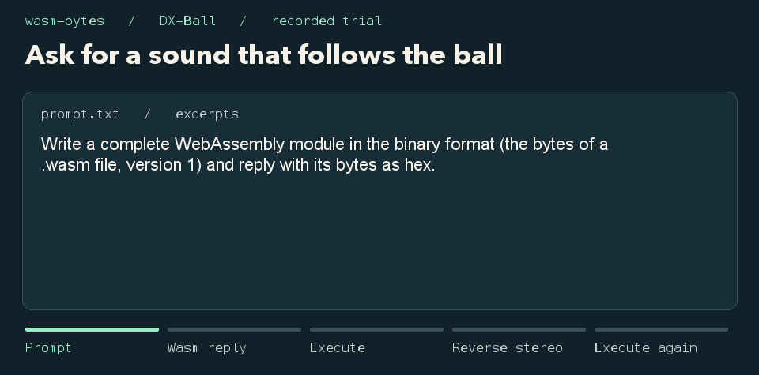

# How we reused a sound rule from DX-Ball

In DX-Ball, a ball hits a brick and the game plays a sound. We wanted to reuse one part of that feature in a browser app: given the position of the hit, how far left or right should the sound play?

**Do you need REA to run this? No.** The REA team used it earlier to study the old game and published the sound rule they found. We used their write-up to prompt Claude and saved the two programs it produced. When you open the demo, your browser runs those files locally. Switching versions takes effect immediately, without calling REA or Claude.

## What did REA do?

REA is a tool that helps you understand how existing software works by inspecting the compiled program. In this case, the REA project examined the instructions in the DX-Ball executable. It identified the calculation the game used when it passed a brick’s position to its sound system. With the game’s usual settings, a hit at the left edge gives −500, the middle gives 0, and the right edge gives 500.

REA’s case study shows the original instructions alongside the same rule written in C, with checks against the old game code. That answers “What did DX-Ball do?” Our question was “Can I describe that rule to Claude and get a file I can use in my own app?” We used the published finding to write the prompt below. [REA’s evidence for this function](https://github.com/morluto/rea/blob/3cfbe81509e4f33780a7d3ef843510e94e042495/website/evidence/dx-ball-sound-pan.md)

## What exactly did we ask Claude?

Here are two excerpts from the prompt we sent.

> Write a complete WebAssembly module in the binary format (the bytes of a .wasm file, version 1) and reply with its bytes as hex.

> screen_pan(x) takes a horizontal screen position x, from 0 at the left edge through 640 at the right edge.

The full prompt also tells Claude how to do the math. Multiply the position by 1.5625, subtract 500, apply a scale of 1, and drop the fractional part. So Claude already knows **what answer to calculate**. Its job is to write **the program that calculates it**, including every byte the browser needs to load it. WebAssembly (Wasm) is the format browsers can run. Hex is a way to write each byte as two characters in a chat reply.

<details>
<summary>Read the complete prompt sent to Claude</summary>

```text
Write a complete WebAssembly module in the binary format (the bytes of a
.wasm file, version 1) and reply with its bytes as hex.

The module implements a function recovered from the x86 code of the game
DX-Ball (version 1.07, 1996). The game calls it with the horizontal screen
position of something that makes a sound, such as a brick that was hit, and
passes the result to its sound routine as a stereo pan value, so that the
sound comes from that side of the screen.

The module exports one function, named "screen_pan", with one i32 parameter
and one i32 result:

  screen_pan(x) takes a horizontal screen position x, from 0 at the left
  edge through 640 at the right edge.
  It computes, in double-precision floating point: x times 1.5625, then
  minus 500.0, then times a scale of 1.0.
  It converts that value to an i32 by truncating toward zero: any fraction
  is dropped, for negative values as for positive ones.
  The result goes from -500 at the left edge to 500 at the right edge. A
  negative value is left of centre, a positive value right of centre.

The module has exactly one function, the exported one, and exports nothing
else. It has no imports, no memory and no start function.

You write every byte: the magic number and version, every section id, every
section length, every function body length, every local declaration and
every instruction. Nothing will be added to your bytes and no length will be
corrected: the bytes you send are the bytes that run.

Reply with only the bytes, as pairs of hexadecimal digits, for example:

0f a0 7c

Whitespace and line breaks between pairs are allowed. Do not split a pair.
Do not add anything else: no explanation, no code fence, no 0x prefix, no
comments.
```

</details>

## What came back?

Claude Sonnet’s reply starts with `00 61 73 6d` and contains 76 bytes in all. We decoded the text into a Wasm file and loaded it in the browser. When the ball is at the right edge, the app calls `screen_pan(640)`, gets back `500`, and plays the beep on the right. [Exact prompt](../trials/pan/claude-sonnet-5-5-1/prompt.txt) · [Complete reply](../trials/pan/claude-sonnet-5-5-1/reply.txt)

Then we gave Sonnet its own bytes with one more instruction.

> Change the module to reverse the stereo: for every x, screen_pan(x) must return the value it returns now with its sign reversed.

Sonnet sent back another 76-byte file. One byte differed. The same app now gets these answers depending on which file it loads. [Full change request](../trials/reverse/claude-sonnet-5-5-1/prompt.txt) · [Revised reply](../trials/reverse/claude-sonnet-5-5-1/reply.txt)

| Where is the ball? | Original program | Revised program |
| --- | --- | --- |
| Left edge (0) | −500 → left speaker | 500 → right speaker |
| Middle (320) | 0 → centered | 0 → centered |
| Right edge (640) | 500 → right speaker | −500 → left speaker |

## What does a developer get out of this?

Say you’re moving a feature from an old desktop app to the web. REA’s analysis can tell you what the old feature did and give you expected answers to test against. This experiment shows the next step for one small rule: ask a model for a file your new app can load, test it, then call it wherever you need that decision. Once you have the file, each call runs locally. You don’t need to ask Claude again every time the ball moves.

You can also change the rule while keeping the app code that uses it. Here, the developer switches which file is loaded. Both versions accept the same position and return one number, so the drawing and audio code work with either version.

Before the browser demo opens, erlang_wasm checks that each file is a valid program and runs it under time and work limits. Our checker compares its answers with the expected ones for all 641 positions. All six recorded replies (an original and a revision from each of three models) passed in both erlang_wasm and Wasmtime. The original game executable was unavailable for these tests. The results cover this one calculation, and our demo chooses how to map the number to its speakers. [Test results and how to reproduce them](dx-ball-evidence.md)

## Hear it

The animation shows the prompt, the generated program, and what each version returns.



To try it locally, run the command below from the repository folder with Erlang/OTP 29 or later and rebar3 installed. It checks the saved replies and opens the demo in your browser.

```sh
bin/wasm-bytes pan-demo
```

Turn **Sound** on. Listen through one sweep in **Original**, then select **Reversed**. Headphones make the change easy to hear. With sound muted, the marker below the ball shows where each beep would play.
