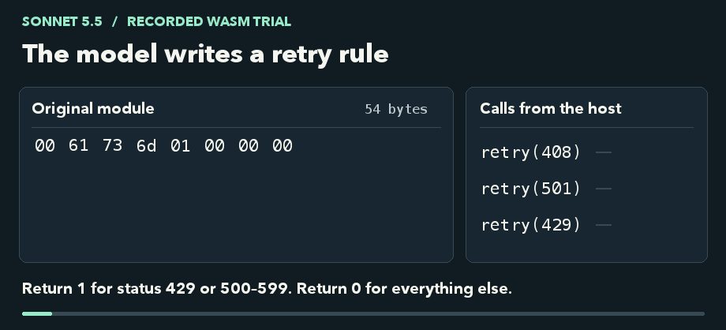

# Try it yourself

This guide shows you how to replay the recorded `retry` trial, run its file in your own tools, and put the same request to a model of your choice. Use it when you want to test a model that isn't in the recorded trials, or check a reply before you rely on it. Run every command from the repository root.

## Before you start

You need Erlang/OTP 29 or later and rebar3. The first command you run fetches erlang_wasm, the WebAssembly runtime this project uses, from Hex and compiles it. Nothing here needs a model account.

```sh
git clone https://github.com/benoitc/wasm-bytes.git
cd wasm-bytes
bin/wasm-bytes replay
```

`replay` checks the saved Sonnet reply and four broken examples, and says which check decided each one. The Sonnet reply ends with this line:

```text
  [model trial] trials/write/claude-sonnet-5-5-1
      pass                validated, accepted by the interface rules, ran within its limits; 528 of 528 answers match the reference
```

## Run the file in your own tools

The reply is the whole `.wasm` file written as text. With `xxd` and [Wasmtime](https://wasmtime.dev/) installed, turn it back into bytes and make the weather app's two calls:

```sh
xxd -r -p trials/write/claude-sonnet-5-5-1/reply.txt > retry.wasm
wasmtime run -W fuel=10000 --invoke retry retry.wasm 429
wasmtime run -W fuel=10000 --invoke retry retry.wasm 404
```

The calls print `1` and `0`. Wasmtime also warns that `--invoke` with arguments is experimental. [Call the same file from Node.js](runner.md#call-the-module-from-nodejs)

To run all 528 test inputs in both erlang_wasm and Wasmtime, and confirm that both engines received identical bytes:

```sh
bin/wasm-bytes compare write trials/write/claude-sonnet-5-5-1/reply.txt
```

```text
  erlang_wasm  0.11.0, received the same bytes: 528 of 528 match the reference
  wasmtime     50.0.1, received the same bytes: 528 of 528 match the reference
  agree        528 of 528 inputs give the same result in both engines
  verdict      pass
```



## Ask your own model

1. **Send the prompt.** Run the command below and paste its entire output into your model. It holds the retry rule, the function the file must export, and how to format the reply. For a small or local model, add `--guided`: that version gives the byte for each instruction and a step-by-step method. [Guided prompts](../trials/README.md#use-the-guided-prompt)

   ```sh
   bin/wasm-bytes prompt write
   ```

2. **Save and check the first reply.** Copy the full response into a plain-text file named `reply.txt`. Keep any explanation or code fence the model added: those count against it. Spaces and line breaks between hex pairs are fine.

   ```sh
   bin/wasm-bytes check write reply.txt
   ```

   On `pass`, keep `reply.txt` for the next step. On any other verdict, the line above `verdict` says where this attempt stopped. [Every verdict](runner.md)

3. **Ask for a change.** The command below checks your base reply and prints a prompt that contains its bytes. Paste that output into the model. This time the app should also retry after a timeout (408) and stop when a server says a feature isn't built (501). Every other answer should stay the same. [A filled-in revision prompt](../prompts/revise.example.txt)

   ```sh
   bin/wasm-bytes prompt revise --base reply.txt
   ```

4. **Check the change.** Save the complete second reply as `revised.txt` and compare it with the same base.

   ```sh
   bin/wasm-bytes check revise revised.txt --base reply.txt
   ```

   `diff` shows which bytes changed. `changes` and `request` show what those edits did to the answers. A passing revision changes the answers for 408 and 501 and keeps the other 526.

Sonnet's own revision passed: it added 14 bytes, and only 408 and 501 changed. [Revision prompt](../trials/revise/claude-sonnet-5-5-1/prompt.txt) · [Revised reply](../trials/revise/claude-sonnet-5-5-1/reply.txt)

## Read a failed check

This saved example is a valid file with one mistake, at the top of the retry range:

```sh
bin/wasm-bytes check write examples/write/misses-599/reply.txt
```

```text
  wrong    1 answer differs from the reference
           input 599: expected 1, got 0
  answers  527 of 528 match the reference
  verdict  wrong_answer
```

The file ran, but it declined to retry status 599. That one input is enough to keep it from being a base for a revision. Other replies fail earlier, for example when the model wraps its answer in a sentence. [Every verdict, and where to look](runner.md)

## Notes

- A pass covers the 528 inputs the checker tried: every status from 100 through 599 and 28 other numbers. It doesn't tell you how often a model succeeds. [What a pass covers](runner.md#what-a-pass-covers)
- To share a run so that someone else can replay it, save the prompt, the reply and the model's details. [Record a trial](../trials/README.md)
- To try another task, replace `write` with `digits` for `digit_sum`, or with `pan` for the DX-Ball sound, whose change request is `reverse` instead of `revise`. [Results for every task](status.md)
